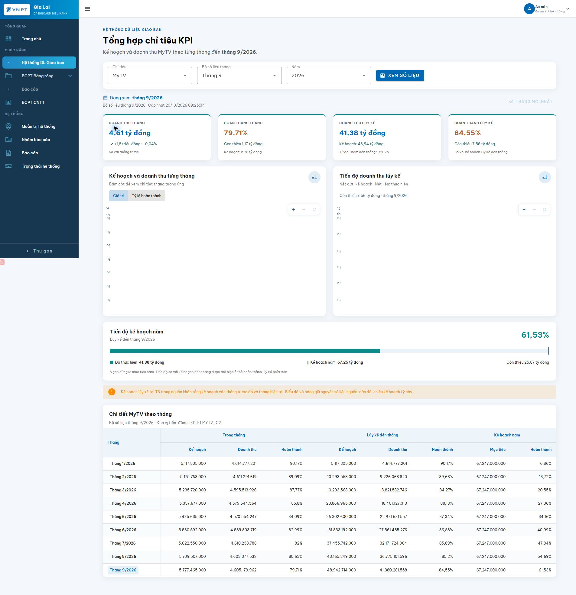

# Đối chiếu Oracle và bố cục báo cáo KPI — 20/10/2026

Đã kết nối trực tiếp Oracle bằng cấu hình backend và chỉ thực hiện SELECT trên bảng `NBH_CDS_NEW.TONGHOP_KPI`. Không cập nhật dữ liệu hoặc gọi proc tổng hợp.

## Phạm vi và kết quả

- BRCD: `F1.FIBER_C2`; MyTV: `F1.MYTV_C2`; TSL: `F1.DITT_C2`.
- Đọc 135 dòng trong 27 bộ số liệu (`THANG_DULIEU` từ `202601` đến `202609`).
- Mỗi bộ chứa các tháng từ tháng 1 đến tháng báo cáo; không thấy dòng trùng, tháng thiếu hoặc trường tiền bị null trong phạm vi kiểm tra.
- `THANG`, `THANG_DULIEU` là VARCHAR2; `KY_CUOC` là NUMBER; các chỉ tiêu tiền/tỷ lệ là NUMBER; `NGAY_CAP_NHAT` là DATE.
- Doanh thu lũy kế khớp tổng doanh thu tháng, sai số cho phép 1 đồng.
- Cả ba tỷ lệ tháng/lũy kế/năm đều khớp phép chia từ các cột nguồn, với sai số làm tròn không quá 0,00501 điểm phần trăm.

## Bộ số liệu mới nhất: 9/2026

| KPI | Doanh thu tháng (đồng) | KH tháng (đồng) | HT tháng | Doanh thu LK (đồng) | KH lũy kế (đồng) | HT lũy kế | KH năm (đồng) | HT năm |
|---|---:|---:|---:|---:|---:|---:|---:|---:|
| BRCD | 33.003.439.954 | 35.534.160.960,04 | 92,88% | 291.358.695.148 | 307.434.574.823,23 | 94,77% | 416.246.000.000 | 70,00% |
| MyTV | 4.605.179.962 | 5.777.465.000 | 79,71% | 41.380.281.558 | 48.942.714.000 | 84,55% | 67.247.000.000 | 61,53% |
| TSL | 2.198.080.352 | 215.333.333 | 1.020,78% | 19.377.912.905 | 1.937.999.997 | 999,89% | 2.584.000.000 | 749,92% |

## Các điểm cần đối chiếu nghiệp vụ

Trong cả ba KPI, KH lũy kế tháng 3 bằng KH lũy kế tháng 2. Chênh lệch này lặp lại ở 21 dòng thuộc các bộ số liệu tháng 3–9. Đây là phát hiện khi đối chiếu với tổng KH tháng, chưa phải kết luận về quy tắc kế hoạch nghiệp vụ.

| KPI | KH lũy kế T3 trong nguồn | Tổng KH T1+T2+T3 | HT lũy kế T3 trong nguồn |
|---|---:|---:|---:|
| BRCD | 65.874.309.548,04 | 99.402.529.089,91 | 144,59% |
| MyTV | 10.293.568.000 | 15.529.288.000 | 134,27% |
| TSL | 430.666.666 | 645.999.999 | 1.534,32% |

TSL có doanh thu tháng cao gấp khoảng 9–11 lần kế hoạch tháng. Tỷ lệ nguồn đúng theo phép chia; cần xác nhận phạm vi KPI và quy mô kế hoạch với người phụ trách dữ liệu trước khi kết luận vượt kế hoạch nghiệp vụ. Không tự chia doanh thu hay nhân kế hoạch để điều chỉnh tỷ lệ.

## Giao diện áp dụng

- Bốn thẻ: doanh thu tháng và tăng/giảm; hoàn thành tháng và tiền vượt/thiếu; doanh thu lũy kế và KH tương ứng; hoàn thành lũy kế và tiền vượt/thiếu.
- Hai biểu đồ: cột ghép kế hoạch/thực hiện từng tháng (có chế độ tỷ lệ tháng); hai đường lũy kế với nét đứt cho kế hoạch và nét liền cho thực hiện.
- Bấm tháng trên biểu đồ hoặc bảng cập nhật các thẻ và tiến độ năm; giữ nguyên bộ số liệu báo cáo. Có nút quay về tháng mới nhất.
- Thanh tiến độ năm có vạch mục tiêu. Nếu thực hiện vượt KH, thang đo mở rộng theo giá trị thực tế và tỷ lệ vẫn hiển thị trên 100%.
- Bảng nhóm cột theo Trong tháng / Lũy kế / Kế hoạch năm, cố định cột tháng. Không cộng các dòng lũy kế hoặc lấy trung bình tỷ lệ.
- Ghi chú chênh lệch KH lũy kế được tính theo dữ liệu đang tải; không hardcode tháng 3 hoặc sửa số liệu Oracle.

## Kiểm tra sau khi sửa

- Chạy trực tiếp `KpiService.latestMonth` và `KpiService.trend` với kết nối Oracle thật cho cả ba KPI: mỗi KPI trả 9 dòng của bộ `202609`; đối chiếu từng trường tiền và tỷ lệ với SELECT trực tiếp đều khớp. Không gọi proc.
- 5 kiểm tra hồi quy backend đã chạy đạt, gồm mapping ba KPI sang bảng snapshot, giữ tỷ lệ trên 100%, giá trị null/kỳ dự phòng và nhánh proc của KPI chưa chuyển nguồn.
- Typecheck Vue, build backend và build frontend đạt. Thư mục assets cũ trên Windows bị khóa khi dọn output; đã hoàn tất build frontend bằng Vite với `emptyOutDir: false` để giữ các assets cũ.
- Kiểm tra trên trình duyệt với Oracle thật: ba KPI hiển thị đúng giá trị tháng 9; bấm cột tháng 5 MyTV cập nhật cả bốn thẻ và tiến độ năm; chuyển chế độ tỷ lệ, zoom/reset hoạt động; không ghi nhận lỗi console trong lượt kiểm tra.
- Viewport 390px: các thẻ/biểu đồ xếp dọc, thanh tiến độ TSL giữ 749,92% và vạch kế hoạch năm; không tràn ngang toàn trang. Đã khôi phục viewport desktop.

